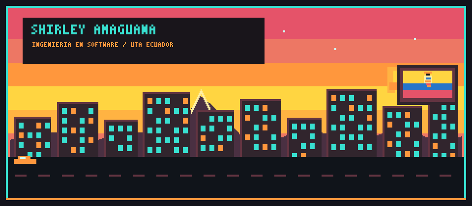
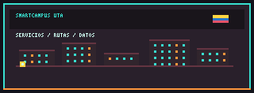
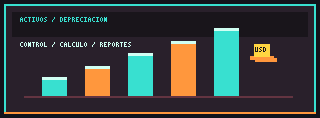
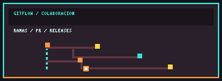
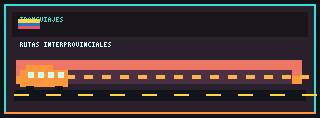
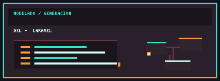

**UTA · FISEI · Ecuador 🇪🇨**  
[Sobre mí](#sobre-mí) · [Tecnologías](#tecnologías) · [Proyectos](#proyectos) · [Contacto](#contacto)

---

## Sobre mí

¡Hola! Soy **Shirley Amaguaña**, estudiante de **Ingeniería de Software** en la **Universidad Técnica de Ambato (UTA – FISEI)**. Me interesa desarrollar aplicaciones web, trabajar con bases de datos y aplicar buenas prácticas de ingeniería de software.

Aquí comparto proyectos académicos y colaborativos en los que he trabajado con diseño, implementación, estructuras de datos, modelado y control de versiones. La identidad visual de este perfil combina una ciudad futurista pixelada con colores neón y un guiño a Ecuador.

## Tecnologías

**Lenguajes**  
Java · C++ · PHP · C# · TypeScript · JavaScript · SQL · PL/SQL · R · HTML · CSS

**Frameworks y librerías**  
Laravel · React · Vite · ASP.NET Core · Entity Framework Core · Java Swing

**Bases de datos**  
SQL Server · MySQL

**Herramientas y modelado**  
Git · GitFlow · GitHub · Eclipse (Ecore, Xtext, Xtend, OCL) · PlantUML · StarUML · Overleaf · Visual Studio · NetBeans

## Proyectos

<table>
<tr>
<td width="34%" align="center"></td>
<td><h3>SmartCampus UTA Web</h3>
Aplicación web de gestión del campus con módulos de turnos, trámites, historial, documentos, rutas y administración. Incluye cola, pila, lista doblemente enlazada, lista circular, árbol N-ario y un grafo con Dijkstra.

<b>Laravel 13 · PHP 8.3 · MySQL 8</b>
</td>
</tr>
<tr>
<td width="34%" align="center"></td>
<td><h3>Sistema de Depreciación de Activos</h3>
Gestión de inmuebles, maquinaria, vehículos y equipos de cómputo. Backend con arquitectura Onion y autenticación; porcentajes contrastados con la normativa tributaria ecuatoriana.

<b>ASP.NET Core · EF Core · SQL Server · React 19 · Vite · TypeScript · JWT · BCrypt</b>
</td>
</tr>
<tr>
<td width="34%" align="center"></td>
<td><h3>Los Backyardigans</h3>
Proyecto colaborativo que pasó de HTML, CSS y JavaScript a React con backend en Node.js. Practicamos ramas, Pull Requests, releases, README, CONTRIBUTING y .gitignore.

<b>Git · GitFlow · GitHub · React · Node.js</b>
</td>
</tr>
<tr>
<td width="34%" align="center"></td>
<td><h3>Prototipo de Control de Cambios — Transviajes</h3>
Formulario de petición de cambios diseñado tras comparar tres propuestas, junto con un prototipo para venta de pasajes interprovinciales. Considera solicitantes sin cuenta y miembros del comité con sesión.
</td>
</tr>
<tr>
<td width="34%" align="center"></td>
<td><h3>Modelamiento y Diseño de Software</h3>
Metamodelado con Eclipse (Ecore, Xtext, Xtend y OCL) y generación de código Laravel a partir de lenguajes específicos de dominio.

<b>Eclipse · Ecore · Xtext · Xtend · OCL · Laravel</b>
</td>
</tr>
<tr>
<td width="34%" align="center"></td>
<td><h3>Misión Estrellita — Pixel Ecuador</h3>
Minijuego web ambientado en los Andes ecuatorianos: recoge estrellas, esquiva nubes y juega contra el tiempo.

<b>HTML · CSS · JavaScript</b> <a href="https://github.com/shirley6126/mision-estrellita">Ver el repositorio</a>
</td>
</tr>
</table>

## Contacto

📧 [shirley.daya1406@gmail.com](mailto:shirley.daya1406@gmail.com) · 💻 [github.com/shirley6126](https://github.com/shirley6126)

**Ideas que toman forma, un proyecto a la vez.**  
🇪🇨 · Hecho con código y pixel art

