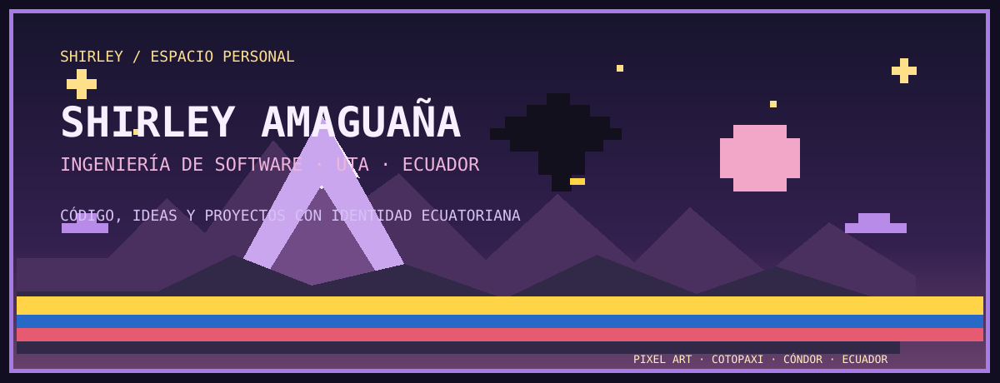

🇪🇨 **UTA · FISEI · Ecuador** 🇪🇨

---

## 👩🏻‍💻 01 / Conóceme

¡Hola! Soy **Shirley Amaguaña**, estudiante de **Ingeniería de Software** en la **Universidad Técnica de Ambato (UTA – FISEI)**. Me interesa construir aplicaciones web, trabajar con bases de datos y aplicar buenas prácticas de ingeniería de software.

Este espacio reúne proyectos académicos, ideas que voy desarrollando y aprendizajes de mi camino en software. Mi identidad visual mezcla los Andes ecuatorianos, el pixel art y una paleta cálida de azul y violeta.

## 🎒 02 / Mi inventario

| 💻 Lenguajes | 🧰 Frameworks | 🗄️ Bases de datos | 🧩 Modelado y herramientas |
|---|---|---|---|
| Java · C++ · PHP · C# | Laravel · React · Vite | SQL Server · MySQL | Eclipse: Ecore, Xtext, Xtend, OCL |
| TypeScript · JavaScript | ASP.NET Core · EF Core | SQL · PL/SQL | PlantUML · StarUML |
| R · HTML · CSS · SQL | Java Swing | | Git · GitFlow · GitHub · Overleaf · Visual Studio · NetBeans |

## 🕹️ 03 / Proyectos destacados

### ⭐ Misión Estrellita — Pixel Ecuador

Un minijuego web ambientado en los Andes ecuatorianos: ayuda a Estrellita a recoger estrellas y esquivar nubes.

**HTML · CSS · JavaScript**  
🎮 [Explorar el código](https://github.com/shirley6126/mision-estrellita)

### 🎓 SmartCampus UTA Web

Aplicación web para gestionar turnos, trámites, historial, documentos, rutas del campus y administración. Implementa estructuras de datos construidas para el proyecto: cola, pila, lista doblemente enlazada, lista circular, árbol N-ario y grafo con Dijkstra.

**Laravel 13 · PHP 8.3 · MySQL 8**

### 📊 Sistema de Depreciación de Activos

Sistema para gestionar la depreciación de inmuebles, maquinaria, vehículos y equipos de cómputo. El backend sigue arquitectura Onion y el frontend ofrece una interfaz web; los porcentajes se contrastaron con la normativa tributaria ecuatoriana.

**ASP.NET Core · EF Core · SQL Server · React 19 · Vite · TypeScript · JWT · BCrypt**

### 🌱 Los Backyardigans

Proyecto colaborativo que evolucionó de HTML, CSS y JavaScript a React con backend en Node.js. Practicamos ramas, pull requests, GitFlow y versiones.

### 🚌 Prototipo de Control de Cambios — Transviajes

Prototipo de un formulario de petición de cambios y flujo de revisión para un sistema de venta de pasajes interprovinciales, basado en el análisis comparativo de tres formularios.

### 🧩 Modelamiento y Diseño de Software

Metamodelado y generación de código Laravel a partir de lenguajes específicos de dominio con herramientas del ecosistema Eclipse.

## 🌱 04 / Siguiente nivel

- Seguir fortaleciendo mis habilidades de desarrollo web y bases de datos.
- Aplicar lo aprendido en nuevos proyectos y mejorar los que ya construí.
- Compartir mi progreso con una identidad visual inspirada en Ecuador.

## 📬 Contacto

📧 [shirley.daya1406@gmail.com](mailto:shirley.daya1406@gmail.com) · 💻 [GitHub](https://github.com/shirley6126)

🟨🟨🟨🟨🟨 🟦🟦 🟥🟥  
**Un proyecto a la vez. Un nuevo aprendizaje en cada paso.** ✨

